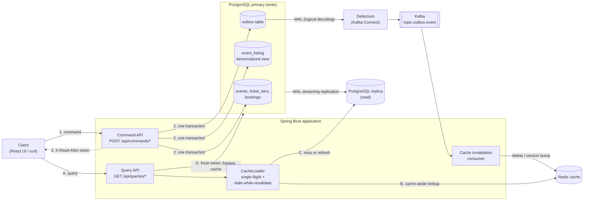

# System Architecture

Detailed design of Event Booking - CQRS with Efficient Caching Strategy. The README has the short version.

## 1. System block diagram



<details>
<summary>Plain-text version of the same diagram</summary>

```
 WRITE PATH
 ==========
                1. command                 2. ONE transaction
 +--------+ ----------------> +-------------+ ------------------> +-----------------------------+
 | Client |                   | Command API |                     | PostgreSQL PRIMARY          |
 | (UI /  | <- - - - - - - -  +-------------+                     |  - events, ticket_tiers,    |
 |  curl) |  3. X-Read-After token                                |    bookings (normalized)    |
 +--------+                                                       |  - event_listing (denorm.)  |
                                                                  |  - outbox                   |
                                                                  +--------+-------------+------+
                                       WAL streaming replication ---------+             |
                                                                  v                      | WAL (logical
                                                      +------------------+               | decoding)
                                                      | PostgreSQL       |               v
                                                      | REPLICA          |        +-------------+
                                                      +------------------+        |  Debezium   |
                                                                                  | (Connect)   |
 INVALIDATION PATH                                                                +------+------+
 =================                                                                       v
 +-------------+  delete key / bump version  +-------------+                      +-------------+
 | Redis cache | <-------------------------- | Invalidation| <------------------- |    Kafka    |
 +-------------+                             | consumer    |                      | outbox.event|
                                             +-------------+                      +-------------+

 READ PATH
 =========
                A. query                 B. lookup
 +--------+ ----------------> +-----------+ ----------> +-------------+
 | Client |                   | Query API | --- C. ---> | CacheLoader | ----> Redis cache (hit / stale)
 +--------+ <---------------- +-----------+             +------+------+
              X-Served-By           |                          | D. miss or background refresh
              X-Cache               |                          v
                                    |                   PostgreSQL REPLICA  (fills Redis)
                                    | E. fresh X-Read-After token: cache bypassed
                                    v
                             PostgreSQL PRIMARY
```

</details>

## 2. Components

| Component | Role | Where |
|---|---|---|
| Client | React UI (`ui/`) or any HTTP client. Keeps the `X-Read-After` token from command responses and sends it on follow-up reads. | `ui/` |
| Command API | Write side. Validates the request, runs one transaction on the primary, returns the token. | `command/` |
| Query API | Read side. Chooses where to read from, adds `X-Served-By` and `X-Cache` headers. | `query/`, `consistency/` |
| PostgreSQL primary | The only database that accepts writes. Holds the normalized tables, the denormalized `event_listing` view and the `outbox` table. | `infra/docker-compose.yml` (`:15432`) |
| Denormalized views | `event_listing` is a read-optimised table, updated in the same transaction as the write model, so a listing query is a single indexed lookup. | migration `V1` |
| Outbox table | A change announcement written in the same transaction as the business change. | migration `V2__outbox.sql` |
| PostgreSQL replica | Streaming replica of the primary. Serves all anonymous reads. Lags the primary by milliseconds to seconds. | `:15433` |
| Debezium (Kafka Connect) | Reads outbox inserts from the primary's WAL and publishes them to Kafka. | `docker/debezium/` |
| Kafka | Durable transport for change announcements (topic `outbox.event`, keyed by event id). | `:29092` |
| Cache invalidation consumer | Reads `outbox.event` and removes the affected Redis entries (twice, see section 5). | `cache/CacheInvalidationConsumer` |
| Caching proxy (`edge`, nginx) | Optional front door on port 8088. Caches public GET query responses for 1 second (`Cache-Control: s-maxage`), collapses concurrent misses, and bypasses requests that carry `X-Read-After`. Stands in for a CDN. | `infra/nginx/nginx.conf` |
| In-process cache (L1) | Each app instance keeps hot entries for 500 ms so most hits need no Redis call. | `cache/LocalCache` |
| Redis | Read cache. Entries have a TTL with jitter and a soft expiry. No persistence, LRU eviction. | `:6379` |
| CacheLoader | Cache-aside lookup with single-flight rebuild and stale-while-revalidate. | `cache/CacheLoader` |

## 3. Write path (command)

1. The client sends a command (create event, book tickets) to the Command API.
2. In **one database transaction** on the primary the handler:
   - writes the normalized tables (`events`, `ticket_tiers`, `bookings`),
   - updates the `event_listing` view,
   - inserts an `outbox` row (and deletes it again in the same transaction, so the table stays empty).
3. After the commit the API returns the response with `X-Read-After: <commit time>`.
4. The primary replicates the committed changes to the replica (physical streaming) and Debezium reads the outbox
   insert from the WAL (logical decoding). Both happen after the commit, so neither can announce a change that
   was rolled back.

Overselling is prevented by an atomic conditional update (`available >= qty`) plus a check constraint.

## 4. Read path (query)

The Query API picks a source from the `X-Read-After` header:

| Request | Source | Cache |
|---|---|---|
| No token, or token older than the window (default 5s) | Replica | Redis first, replica on a miss |
| Token younger than the window | Primary | Bypassed (neither read nor filled), so the caller sees their own write |

If a caching proxy is in front (port 8088), it answers repeated public GETs itself for up to a second. See
[cache-advanche.md](../cache-advanche.md).

For a replica read, `CacheLoader` first checks this instance's own memory (`X-Cache: local`), then does the following:

- **fresh entry**: return it (`X-Cache: hit`)
- **soft-expired entry**: return it and refresh it in the background, by one request only (`stale`)
- **no entry**: one request reads the replica and fills Redis, the others wait for it (`miss` for the one,
  `coalesced` for the rest)

Details and the reasoning: [single-flight-vs-stale-while-revalidate.md](../single-flight-vs-stale-while-revalidate.md).

## 5. Cache invalidation path

1. A command commits and writes the outbox row.
2. Debezium publishes it to Kafka (`outbox.event`, key = event id, payload `{type, eventId, city}`).
3. The consumer deletes the event's detail key and bumps the version of the affected listings (one bump retires
   every page of a listing).
4. **A second invalidation runs after the read-after window** (5s). Between the first one and the replica
   catching up, a reader can miss, read a still-lagging replica and cache the old value. The second invalidation
   removes it.

Entries also expire by TTL, which is the safety net if Kafka or Debezium is down. See
[cache-ttl-and-invalidation.md](../cache-ttl-and-invalidation.md).

## 6. Consistency model

| Reader | Guarantee |
|---|---|
| The user who just wrote | Read-your-writes. Their token routes reads to the primary for the window. |
| Everyone else | Eventually consistent: they see a change after replication and invalidation, normally within seconds. |

The window (`app.consistency.read-after-window`) must stay above the worst-case replication lag. The token is an
opaque string, so it can later be replaced by a WAL position (LSN) without changing clients.

## 7. Failure behaviour

| Failure | Effect |
|---|---|
| Redis down | Reads fall through to the replica (still coalesced inside each JVM). Slower, not unavailable. Invalidation fails and Kafka redelivers. |
| Kafka or Debezium down | Writes are unaffected. Cached entries stay until their TTL (events 60s, listings 30s), then are rebuilt. The outbox change is replayed from the WAL slot when Debezium returns. |
| Replica down or lagging | Anonymous cache misses are slow or fail. Cached entries keep being served. Token holders still read the primary. |
| Primary down | Writes fail. Cached reads continue. |
| App instance dies mid-rebuild | The Redis rebuild lock expires (5s) and waiters stop waiting after 1s. |

## 8. Scaling notes

- **Reads scale horizontally**: add app instances and replicas. Redis absorbs repeated reads, and the cache loader
  keeps a hot key to one replica query per expiry across all instances.
- **Writes** go to a single primary. The outbox row adds one insert and one delete per command, and no
  cross-system transaction is needed.
- **Redis** is a pure cache with a memory cap and LRU eviction. Losing it loses no data.

## 9. Deployment

`infra/docker-compose.yml` runs the primary, replica, Redis, Kafka, Debezium (Connect), a one-shot connector
registration job and the app. The UI runs separately (`scripts/ui.sh`). See the README for the commands.
